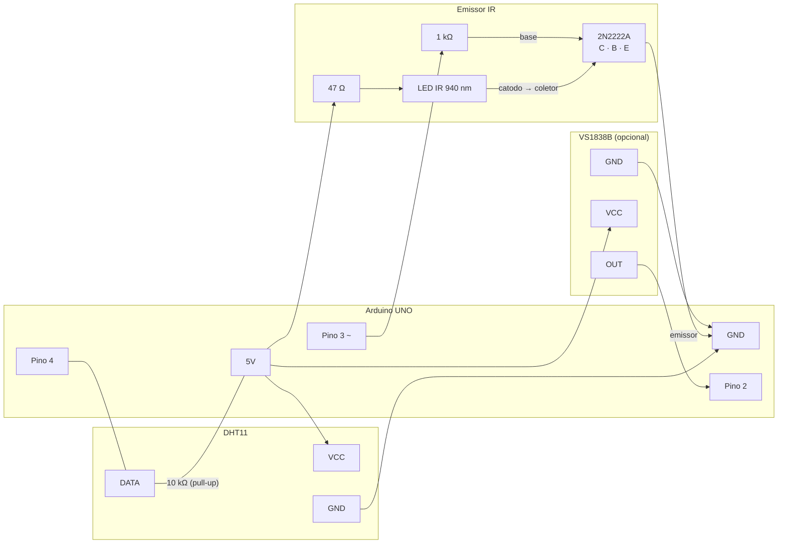

# Controle de umidade com Arduino e ar condicionado Samsung

Circuito que mede a umidade de uma sala fechada e sem janela e liga o ar condicionado em modo **Dry (desumidificar)** quando ela passa do limite. O objetivo é evitar mofo.

O Arduino lê um sensor DHT11 e controla o ar por **infravermelho**, imitando o controle remoto original. Não há nenhuma ligação elétrica com o aparelho.

## Componentes

| Qtd | Componente | Função |
|---|---|---|
| 1 | Arduino UNO (ou compatível, como o RoboCore BlackBoard) | Controle |
| 1 | Sensor DHT11 (4 pinos) | Umidade e temperatura |
| 1 | LED infravermelho emissor 940 nm, 5 mm | Envia os comandos ao ar |
| 1 | Transistor NPN 2N2222A | Fornece a corrente do LED IR |
| 1 | Resistor 47 Ω | Limita a corrente do LED IR |
| 1 | Resistor 1 kΩ | Base do transistor |
| 1 | Resistor 10 kΩ | Pull-up da linha de dados do DHT11 |
| 1 | Receptor IR VS1838B (opcional) | Captura os sinais do controle original |
| — | Protoboard, jumpers e cabo USB | Montagem e alimentação |

## Ligações

| Componente | Pino | Liga em |
|---|---|---|
| **DHT11** | 1 – VCC | 5V |
| | 2 – DATA | Pino **4** + resistor de 10 kΩ até 5V |
| | 3 – NC | — |
| | 4 – GND | GND |
| **2N2222A** | Base | Resistor de 1 kΩ até o pino **3** |
| | Coletor | LED IR (−) |
| | Emissor | GND |
| **LED IR** | Anodo (+), perna longa | Resistor de 47 Ω até 5V |
| | Catodo (−), perna curta | Coletor do 2N2222A |
| **VS1838B** | OUT | Pino **2** |
| | GND | GND |
| | VCC | 5V |

O LED IR **precisa** ficar no pino 3, porque é o pino que a biblioteca IRremote usa para gerar a portadora de 38 kHz no UNO.



### Esquema do emissor IR

```
 5V ──[47 Ω]──►|── LED IR ──┐
                            │ C
 Pino 3 ──[1 kΩ]────────── B  2N2222A
                            │ E
 GND ───────────────────────┘
```

## Como funciona

- O Arduino lê a umidade a cada **30 s**.
- Com a umidade em **55 % ou mais**, ele liga o ar em Dry. Com **45 % ou menos**, desliga.
- Tempos mínimos de **20 min ligado** e **10 min desligado** protegem o compressor.
- Os comandos de ligar e desligar são **cópias exatas dos sinais do controle Samsung**, gravadas com o VS1838B. O protocolo Samsung AC das bibliotecas prontas não funcionou com o modelo AR18BSHZ.

Os limites e os tempos ficam no bloco `CONFIGURAÇÃO`, no início de [controle_umidade.ino](controle_umidade/controle_umidade.ino).

## Bibliotecas (Arduino IDE)

- **IRremote**, de Armin Joachimsmeyer
- **DHT sensor library**, da Adafruit, com a dependência *Adafruit Unified Sensor*

## Capturar os comandos de outro controle

Grave o sketch abaixo, aponte o controle para o VS1838B e copie o `rawIRTimings` que aparecer no Monitor Serial (115200) para `CMD_LIGAR` ou `CMD_DESLIGAR`.

```cpp
#define RAW_BUFFER_LENGTH 400
#define RECORD_GAP_MICROS 20000   // a pausa inicial do Samsung tem cerca de 12,8 ms
#include <IRremote.hpp>

void setup() {
  Serial.begin(115200);
  IrReceiver.begin(2);
}

void loop() {
  if (IrReceiver.decode()) {
    IrReceiver.compensateAndPrintIRResultAsCArray(&Serial, true);
    IrReceiver.resume();
  }
}
```

O comando de ligar grava **todo o estado do controle**: modo, temperatura e flap. Para o modo Dry funcionar, configure no controle uma temperatura **abaixo** da temperatura da sala antes de capturar. Caso contrário, o compressor não liga.

## Situação e próximos passos

Veja [PENDENCIAS.md](controle_umidade/PENDENCIAS.md).
